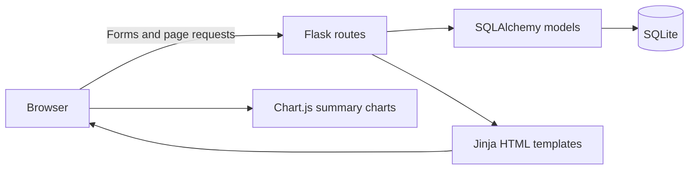
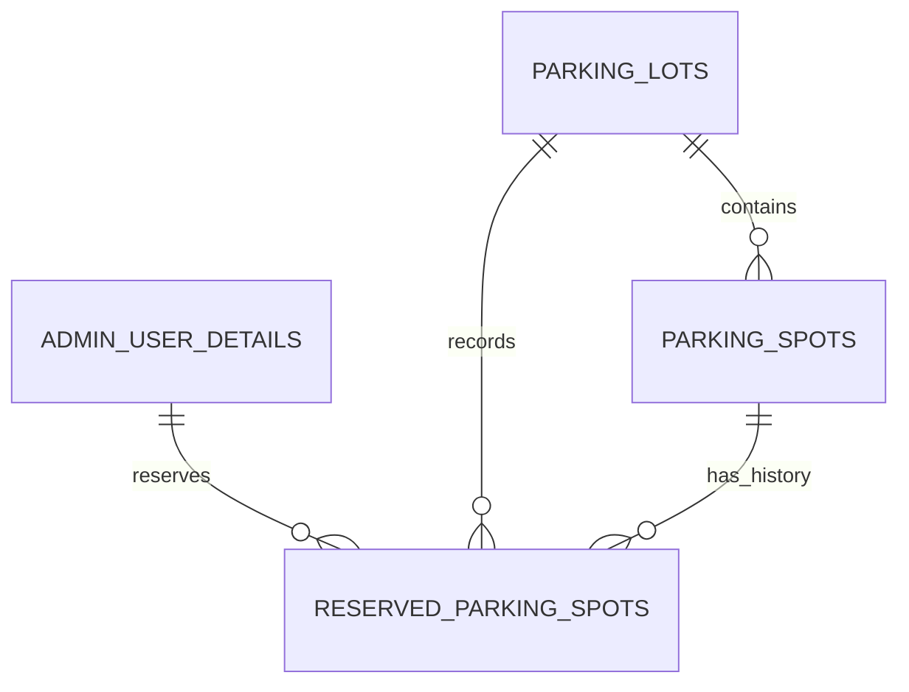

# Vehicle Parking App

A Flask application for managing parking lots, individual parking spots, and vehicle reservations. Administrators configure parking capacity and view occupancy, while users search for available parking, book a spot, and release it when leaving.

The application is a server-rendered Modern Application Development project: Flask handles requests, Jinja templates render the interface, and SQLite stores users, lots, spots, and reservations.

## Contents

- [Features](#features)
- [Architecture and technology](#architecture-and-technology)
- [Repository structure](#repository-structure)
- [Local setup](#local-setup)
- [Accounts and first-use walkthrough](#accounts-and-first-use-walkthrough)
- [Data model](#data-model)
- [Application routes](#application-routes)
- [Reservation and pricing behavior](#reservation-and-pricing-behavior)
- [Verification and troubleshooting](#verification-and-troubleshooting)
- [Current limitations](#current-limitations)

## Features

| User type | Functionality |
| --- | --- |
| Administrator | Create and edit parking lots, configure hourly rates and capacity, inspect available/occupied spots, list registered users, edit the administrator profile, search records, and view summary charts. |
| Registered user | Search parking by location or pincode, book an available spot with a vehicle number, view the latest five reservations, release a reservation, update profile information, and view usage by parking lot. |

Creating a lot also creates its individual parking spots. A reservation changes a spot from `available` to `occupied`; releasing it records the leaving time and changes the spot back to `available`.

## Architecture and technology



| Layer | Technology |
| --- | --- |
| Web application | Python, Flask |
| Persistence | Flask-SQLAlchemy and SQLite |
| Interface | Jinja2 templates, HTML, CSS |
| Charts | Chart.js loaded from jsDelivr in the summary templates |

There is no separate JavaScript application, Node.js build, or JSON API service to start.

## Repository structure

```text
Vehicle-Parking-App/
|-- app.py                         # Flask setup, database initialization, startup
|-- backend/
|   |-- Models.py                  # SQLAlchemy models
|   `-- controlers.py              # Page routes and parking operations
|-- instance/
|   |-- vehicle_parking.sqlite3    # Active application database
|   `-- quiz_master.sqlite3        # Additional tracked database; not used by app.py
|-- templates/
|   |-- login.html
|   |-- register.html
|   |-- a_*.html                   # Administrator pages
|   `-- u_*.html                   # User pages
|-- static/style.css
|-- Parking App (1).png
`-- README.md
```

The filename spellings `Models.py` and `controlers.py` are intentional references to the existing files. Preserve their casing when running on a case-sensitive filesystem.

An additional project image is available in [Parking App (1).png](Parking%20App%20%281%29.png).

## Local setup

### 1. Clone and create an environment

Use Python 3.11 or newer as a starting point. This repository does not currently provide a dependency manifest or pin package versions.

```bash
git clone https://github.com/23f3002149/Vehicle-Parking-App.git
cd Vehicle-Parking-App
python -m venv .venv
```

Activate it in PowerShell:

```powershell
.\.venv\Scripts\Activate.ps1
```

Or on macOS/Linux:

```bash
source .venv/bin/activate
```

### 2. Install the imported application dependencies

```bash
python -m pip install Flask Flask-SQLAlchemy
```

Flask supplies Jinja2, and Flask-SQLAlchemy supplies SQLAlchemy. Python's standard library includes the SQLite driver used here. npm, Redis, and an external database server are not required.

### 3. Run the application

From the repository root:

```bash
python app.py
```

Open `http://127.0.0.1:5000/`.

Startup runs `db.create_all()`, which creates missing tables. The configured database is `instance/vehicle_parking.sqlite3`; it is already tracked in the repository and may contain existing records. Back it up before experimenting with existing data. `create_all()` does not migrate an older schema.

No `.env` loader is configured. The SQLite URI, session secret, and development debug settings are defined directly in [app.py](app.py).

## Accounts and first-use walkthrough

Registration creates a regular user with `role = 1`. Administrators use `role = 0`; the application does not automatically create a new administrator on an empty database.

To create a local administrator without depending on credentials in the bundled database:

1. Register an account at `/register` using details you control.
2. Stop the application.
3. Open `instance/vehicle_parking.sqlite3` in a SQLite editor and promote only that account, replacing the example email:

```sql
UPDATE admin_user_details
SET role = 0
WHERE email = 'your-registered-email@example.com';
```

4. Save the database, restart `python app.py`, and sign in with that account.

The current implementation stores passwords directly, so use a disposable local-demo password. Password hashing and protected routes are listed under [Current limitations](#current-limitations).

For a walkthrough:

1. As administrator, create a lot with a unique location name, address, pincode, hourly price, and a small positive capacity.
2. Confirm that the dashboard displays the generated spots as available.
3. Register and sign in as a separate regular user.
4. Search for the lot, select **Book**, enter a vehicle number, and submit.
5. Inspect the reservation history and the administrator's occupied-spot count.
6. Release the reservation and confirm that the spot becomes available again.
7. Open the user and administrator summary pages.

## Data model

| Model / table | Main fields and purpose |
| --- | --- |
| `Admin_User_Details` / `admin_user_details` | Numeric ID, unique email, full name, password, address, pincode, and role. |
| `Parking_Lots` / `parking_lots` | Location name, address, pincode, hourly price, and maximum number of spots. |
| `Parking_Spots` / `parking_spots` | Parent lot and `available`/`occupied` status. |
| `Reserved_parking_spots` / `reserved_parking_spots` | Spot, lot, user reference, vehicle number, arrival time, leaving time, and the hourly rate captured at booking. |



The reservation model declares `user_id` as a string foreign key to the user's **email**, while the routes pass and query numeric user IDs. This inconsistency is present in the current implementation and should be resolved before relying on relational integrity or changing database engines.

## Application routes

These endpoints render HTML or process forms; they are not a versioned REST API.

| Method | Route | Purpose |
| --- | --- | --- |
| GET, POST | `/` | Login and role-based redirect. |
| GET, POST | `/register` | Regular-user registration. |
| GET | `/admin_home` | Lot and spot occupancy dashboard. |
| GET | `/admin_users` | Registered regular users. |
| GET | `/admin_summary` | Revenue-labelled and occupancy charts. |
| GET, POST | `/admin_profile` | Administrator profile. |
| GET, POST | `/add_lot` | Create a lot and its spots. |
| GET, POST | `/edit_lot/<lot_id>` | Update lot details and capacity. |
| GET | `/delete_lot/<lot_id>` | Delete a lot and its related records. |
| GET | `/admin_search_functionality` | Search using `filter` and `query` parameters. |
| GET | `/user_home/<user_id>` | User dashboard and `search` query filtering. |
| GET | `/user_summary/<user_id>` | Reservation counts grouped by lot. |
| GET, POST | `/user_profile/<user_id>` | User profile. |
| GET | `/book/<spot_id>/<lot_id>/<user_id>` | Booking form. |
| POST | `/book_spot` | Create a reservation. |
| POST | `/release_spot/<reservation_id>` | Record leaving time and free the spot. |

The administrator search supports `user_id`, `spot_id`, and `location` filters. Route definitions and form handling are in [backend/controlers.py](backend/controlers.py).

## Reservation and pricing behavior

**Booking:** the server checks whether the selected spot exists and is not occupied, marks it occupied, reads the lot's current hourly rate, and records a reservation with `datetime.now()`.

**Release:** the server records a leaving timestamp and makes the associated spot available. The reservation remains in the database as history.

**Capacity changes:** increasing capacity adds spots. Decreasing capacity attempts to remove available spots and checks occupied count. However, the controller commits the new lot capacity before that validation, so an invalid reduction can leave the stored capacity inconsistent with the actual spots.

**Pricing:** the reservation stores the hourly rate at booking. The current release route does **not** calculate elapsed hours or a final amount. The administrator's revenue-labelled chart sums reservation hourly-rate values; it is not an accurate duration-based earnings report. A future billing implementation would need an explicit rounding/minimum-duration policy and a persisted final charge.

No payment gateway or payment collection flow is included.

## Verification and troubleshooting

There is no automated test suite in the repository. The walkthrough above provides a manual check of the main flow. Also inspect these cases while developing:

- A lot with no free spots should not appear in the user's available-lot list.
- Attempting to book an already occupied spot returns an error.
- Released reservations retain both timestamps.
- Summary charts reflect reservation counts and current spot occupancy.

| Symptom | What to check |
| --- | --- |
| `No module named flask` or `flask_sqlalchemy` | Activate the virtual environment and install both dependencies. |
| Port `5000` is occupied | Stop the other local Flask application before starting this one. |
| Missing administrator/profile errors on a fresh database | Register and promote a local administrator as described above. |
| Charts do not render | Chart.js is loaded from jsDelivr; inspect network access and the browser console. |
| History or relationship results look inconsistent | Review the reservation `user_id` mismatch between the model and routes. |
| Schema changes are not reflected | `db.create_all()` creates tables but does not alter existing tables; use a deliberate migration. |

## Current limitations

- Login redirects according to role, but the application does not establish and enforce authenticated sessions across administrator/user routes. Direct URLs and user IDs are not adequate authorization.
- Passwords are stored without hashing; the session secret is hardcoded and debug mode is enabled.
- Lot deletion does not check for occupied spots before deleting. Cascading relationships can remove reservations along with the lot.
- Capacity validation occurs after an initial commit, as described above.
- The reservation user foreign key and route-level user identifiers disagree.
- Booking lacks a database-level concurrency mechanism for preventing simultaneous reservations of the same spot.
- Duration-based billing and payment handling are not implemented.
- Several detail templates exist without corresponding dynamic route implementations; the routed workflow above reflects the current controller.
- The repository contains database snapshots and Python bytecode, and has no dependency lock, migration framework, or automated tests.

These are implementation follow-ups for a production version. This README documents the existing project; it does not imply those changes have been implemented.

No license file is currently included in this repository.
